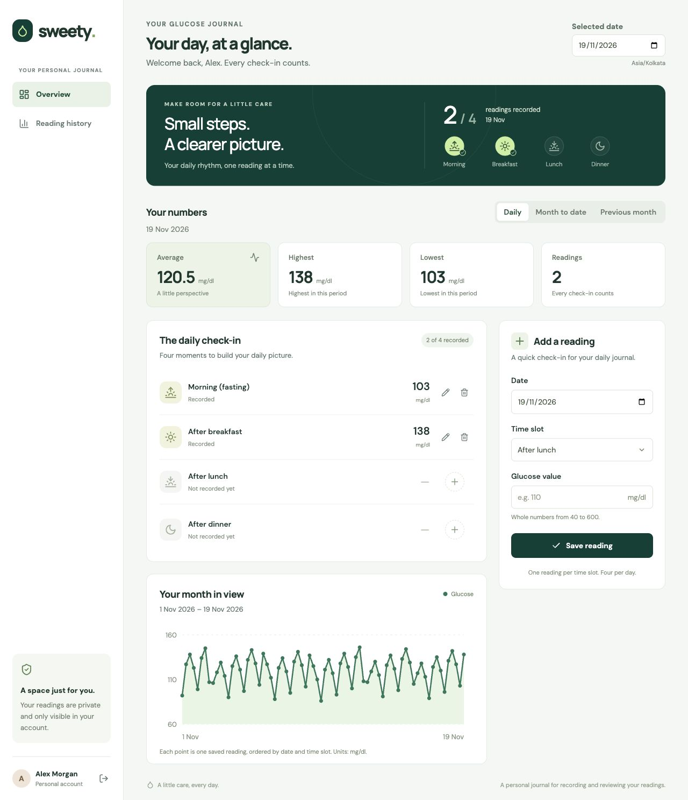

# Sweety

A private glucose journal built with **React, Node.js, Express and PostgreSQL**. Record up to four readings per date, manage past readings, and review daily, month-to-date and previous-month reports.



## Features

- Registration and login with bcrypt password hashing (cost 12).
- Opaque, revocable seven-day sessions in HttpOnly cookies. Only session token hashes are stored in PostgreSQL.
- Each account can access only its own readings and reports.
- Create, view, edit and delete readings in four fixed slots: Morning (fasting), After breakfast, After lunch and After dinner.
- Clear form and API validation: required whole-number glucose values from 40 to 600 mg/dl, valid dates that are not in the future, and one reading per slot per date.
- Highest, lowest, average to one decimal place and count for all three reports; daily readings include their slot. Empty periods have a friendly empty state and no invented statistics.
- Bonus features: paginated reading history, a monthly line chart, Docker Compose, and React Testing Library tests.

## Quick start without Docker

Requires Node.js **22.12+** (Node 24 LTS recommended) and npm. Run all commands from the repository root. The optional embedded database is real PostgreSQL, installed from npm for the host platform; the app uses the standard `pg` driver in every mode.

```sh
npm ci
cp .env.example .env
```

In terminal 1, start the local development database:

```sh
npm run db:local
```

Keep it running. It listens on `127.0.0.1:5432` and persists data in ignored `.local-db/`. If port 5432 is occupied, set `LOCAL_DB_PORT` and update the port in `DATABASE_URL` to match. This convenience database uses the fixed, local-only credentials shown in `.env.example`; use your own PostgreSQL service for deployment.

In terminal 2:

```sh
npm run db:migrate
npm run db:seed
npm run dev
```

Open **http://localhost:5173**. Use that hostname to match `APP_ORIGIN`.

| Demo login | Value               |
| ---------- | ------------------- |
| Email      | `demo@sweety.local` |
| Password   | `SweetyDemo2026!`   |

These are synthetic demo credentials, not production secrets. The seed creates the demo user, a full previous month, and readings through today. Today initially has two readings. Running the seed again preserves existing passwords/readings and fills only missing sample slots. `DEMO_EMAIL` and `DEMO_PASSWORD` customize a newly created demo account.

Stop development processes with Ctrl+C. The local database keeps its data. The bundled PostgreSQL launcher is intended for a regular non-root user. On unsupported hosts or root-only containers, use Docker or an existing PostgreSQL server instead.

## Use an existing PostgreSQL server

PostgreSQL 17 or later is recommended. Create a dedicated database and role (for example, `sweety`), set `DATABASE_URL` in `.env`, then run:

```sh
npm run db:migrate
npm run db:seed
npm run dev
```

The initial schema migration is transactional and safe to run repeatedly. No table is dropped. The runtime account needs access to the three app tables; the migration account also needs permission to create tables and indexes.

## Docker Compose

Docker is optional. The Compose file provides a PostgreSQL 17 database and the built app for a **local demo**:

```sh
docker compose up --build -d
docker compose exec app node server/db/seed.js
```

Open **http://localhost:3001** and use the demo account above. The app waits for database health and runs the migration before serving. Run `docker compose down` to stop; the named volume remains. Do not run the embedded database and Compose database on the same port.

To use only the Docker database with the Vite dev server:

```sh
docker compose up -d db
npm run db:migrate
npm run db:seed
npm run dev
```

The Compose configuration uses local-only ports and example credentials. For public deployment, supply real database credentials, HTTPS, `NODE_ENV=production`, `COOKIE_SECURE=true`, the exact HTTPS `APP_ORIGIN`, and `SERVE_CLIENT=true`. Do not publish the demo credentials as production credentials. Express deliberately refuses an insecure production cookie configuration.

## Run the server and client separately

```sh
# Terminal 1: API at http://127.0.0.1:3001
npm run dev:server

# Terminal 2: React at http://localhost:5173
npm run dev:client
```

Vite proxies `/api` to Express, so the browser uses one origin and no cross-origin credential sharing. A write requires an `Origin` header matching `APP_ORIGIN`; this also applies to API clients such as curl.

## Build and serve

```sh
npm run build
```

To preview the built app locally, stop `npm run dev`, set these values in `.env`, and run `npm start`:

```dotenv
APP_ORIGIN=http://localhost:3001
SERVE_CLIENT=true
NODE_ENV=development
COOKIE_SECURE=false
```

Open http://localhost:3001. Restore the development values before using Vite again. `npm start` does not automatically migrate or seed the database.

## Tests

```sh
npm test
npm run test:server
npm run test:client
```

The server suite starts a temporary real PostgreSQL instance, creates a random isolated test database, and drops it after the run. It never connects to the app's `DATABASE_URL`. To supply your own test PostgreSQL server, set `TEST_DATABASE_URL` to a connection with `CREATEDB` permission. A unique test database is created and removed on that server; existing databases are untouched. Export the variable in your shell (the test suite does not load `.env`).

The tests cover:

- Password/session hashing, normalized and duplicate emails, bcrypt byte limits, login, logout and session expiry.
- Authentication, cross-account isolation and cross-origin request rejection.
- Reading CRUD, invalid inputs, edit conflicts, concurrent duplicates, and database constraints.
- Daily, month-to-date and previous-month aggregates, boundary inclusivity, leap years, January rollover, rounding and empty reports.
- Pagination, slot order and date filters.
- Form errors, successful submission, server error handling and editing/cancel behavior.

Verification performed in this workspace: **16 server/domain tests and 7 frontend tests passed**, production Vite build succeeded, and npm audit reported **0 vulnerabilities** at the time of verification. Browser verification and screenshots are described in [docs/verification.md](docs/verification.md). Docker was not installed on the verification host, so the Compose workflow is provided but was not run here.

## Environment variables

Every app setting is listed in `.env.example`. No real secrets belong in Git.

| Variable                      | Purpose                                                                      |
| ----------------------------- | ---------------------------------------------------------------------------- |
| `DATABASE_URL`                | PostgreSQL connection string; required by the API and database scripts.      |
| `PORT`, `HOST`                | API listening port and address; defaults `3001`, `127.0.0.1`.                |
| `APP_ORIGIN`                  | Exact browser origin allowed for writes, without a trailing slash.           |
| `APP_TIMEZONE`                | IANA timezone used to define today; defaults to `Asia/Kolkata`.              |
| `NODE_ENV`                    | `production` enables the mandatory HTTPS/secure-cookie configuration checks. |
| `COOKIE_SECURE`               | `true` sends cookies only over HTTPS; defaults to true in production.        |
| `SERVE_CLIENT`                | `true` serves the built React app from Express.                              |
| `DEMO_EMAIL`, `DEMO_PASSWORD` | Account credentials used only by the explicit seed command.                  |
| `TEST_DATABASE_URL`           | Optional external test-server connection; use a role with `CREATEDB`.        |
| `LOCAL_DB_PORT`               | Optional port for the embedded development database.                         |

## API

All routes are under `/api`. Protected routes use the session cookie. Validation errors return `{ "message": "...", "fields": { "value": "..." } }`; `fields` is optional. No passwords or session hashes are returned.

| Method   | Route                                       | Purpose                                                   |
| -------- | ------------------------------------------- | --------------------------------------------------------- |
| `GET`    | `/health`                                   | Database connectivity check.                              |
| `GET`    | `/config`                                   | Current application date and timezone.                    |
| `POST`   | `/auth/register`                            | `{name,email,password}`; creates account and session.     |
| `POST`   | `/auth/login`                               | `{email,password}`; creates/rotates session.              |
| `POST`   | `/auth/logout`                              | Revokes the current session.                              |
| `GET`    | `/auth/me`                                  | Returns current safe account details.                     |
| `GET`    | `/readings?page=1&limit=20&date=2026-10-15` | Paginated own readings; date is optional, limit is 1-100. |
| `POST`   | `/readings`                                 | `{date,slot,value}`; creates a reading.                   |
| `PUT`    | `/readings/:id`                             | Replaces a reading's date, slot and value.                |
| `DELETE` | `/readings/:id`                             | Deletes an owned reading.                                 |
| `GET`    | `/reports?kind=daily&date=2026-10-15`       | Returns range, summary statistics and ordered readings.   |

Slots: `morning`, `after_breakfast`, `after_lunch`, `after_dinner`. Reports: `daily`, `month-to-date`, `monthly`. A report's `monthly` kind is explicitly the **entire previous month**. For 15 October 2026: daily is 15 October, MTD is 1-15 October, and monthly is 1-30 September.

## Structure

```text
client/              React screens, components, styles and form tests
server/src/          Express app, authentication, reading/report routes
server/db/           SQL schema, migration and seed scripts
server/test/         API integration tests and date/validation tests
shared/domain.js     Slot definitions, date helpers and shared form validation
scripts/local-db.js  Optional local PostgreSQL launcher
docs/                Verification notes and actual browser screenshots
```

## Notes

**Assumptions**

- The brief says MERN + PostgreSQL but explicitly requests PostgreSQL; this app uses PostgreSQL and does not add MongoDB.
- Readings store calendar dates, not measurement timestamps. An app-wide configurable timezone determines today. Browser config is fetched on page load; refresh a long-running tab after midnight.
- The earliest accepted date is 1 January 1900. Future readings and future report-selection dates are rejected. The four slots describe the patient's chosen category; no clock-time enforcement is assumed.
- Four allowed slot values plus `UNIQUE(user_id, date, slot)` make a fifth reading impossible. Per-user row locks make conflict checks consistent across concurrent writes. A duplicate-slot error takes precedence if both the daily maximum and slot uniqueness apply.
- Statistics include recorded values only. No-data averages/min/max are `null`; the UI shows a dash, while the count is zero. The UI formats averages with exactly one decimal.
- All seed data is fictional. The chart simply plots saved values in chronological slot order; it does not assign clinical targets, diagnoses or medication guidance.
- Authentication uses server-side sessions instead of JWTs so logout immediately revokes access. Cookies are HttpOnly and SameSite=Lax; writes additionally require a matching Origin header. Login/registration are rate limited to 30 requests per 15 minutes per IP.
- The initial schema is idempotent; schema evolution would use numbered migrations. Reads and deletes are account-scoped; missing and unowned IDs both return 404.
- Google Fonts improve typography when available, with system sans-serif fallbacks. Core features do not require that external stylesheet.
- This implementation was prepared with Codex assistance. Commits use a Codex identity and preserve the actual development sequence.

**With more time**

- Add password reset/email verification, per-user timezone settings, stronger session-management controls, and automated accessibility/end-to-end regression tests.
- Add production deployment configuration, TLS/database backup procedures, a shared rate-limit store for multiple API instances, and automated expired-session cleanup.
- Consider larger date-range exports and multiple chart series for individual slots, based on user feedback.
- Redis, background reminders and doctor accounts are intentionally omitted; the required patient flow is complete.

## Screenshots

All screenshots use the fictional seeded account:

- [Login](docs/screenshots/01-login.jpg)
- [Daily dashboard](docs/screenshots/02-dashboard.jpg)
- [Previous-month report](docs/screenshots/03-monthly-report.jpg)
- [Paginated history](docs/screenshots/04-history.jpg)
- [Mobile layout](docs/screenshots/05-mobile.jpg)
- [Empty report](docs/screenshots/06-empty-state.jpg)

## Submission

The repository is ready to review and push to a public GitHub repository. It includes incremental Git commits, source, the lockfile, `.env.example`, setup instructions, seed script, tests and screenshots. No GitHub repository has been created or pushed, and no email has been sent by this implementation task.
